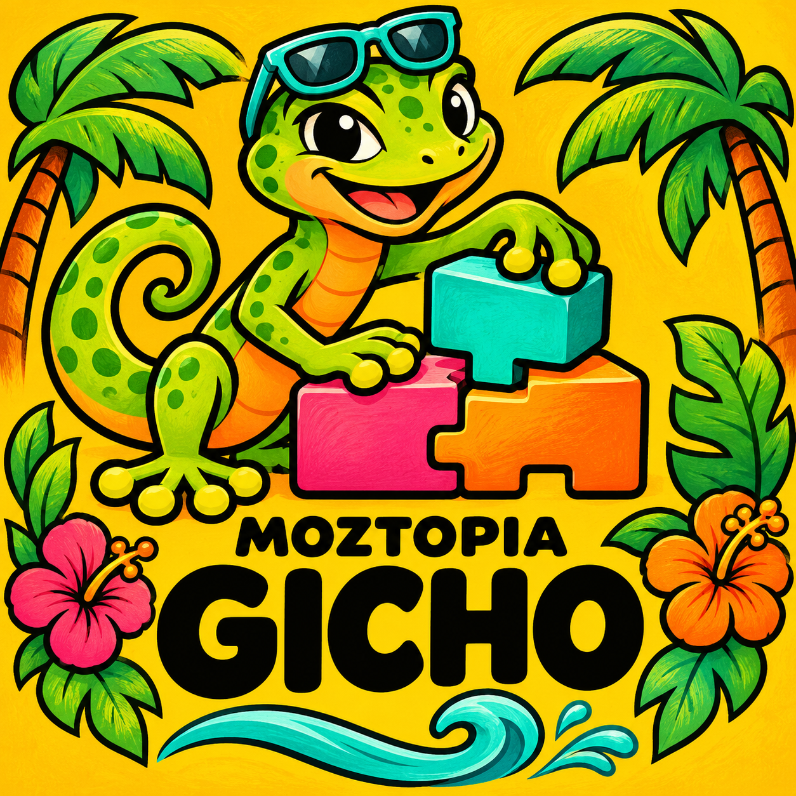

<p align="center">
  <a href="https://github.com/mozrin/gicho/wiki">
    
  </a>
</p>

<h1 align="center">Gicho</h1>
<p align="center"><strong>Solid foundations. Tropical energy.</strong><br>Reusable Flutter foundations, pronounced <em>Gee-cho</em>.</p>

<p align="center">
  <a href="https://github.com/mozrin/gicho/wiki"><strong>Explore the wiki →</strong></a>
  &nbsp; · &nbsp;
  <a href="examples/README.md">Try the examples</a>
  &nbsp; · &nbsp;
  <a href="docs/migration.md">Migrate from Flackage</a>
  &nbsp; · &nbsp;
  <a href="LICENSE">MIT licensed</a>
</p>

---

Build your app on shared configuration, localization, startup, themes and UI.
**One package. One repository.** Catalogs, assets, examples and tooling live here;
there are no first-party companion packages or private-repository requirements.

- **Start cleanly** — configuration inheritance, schema validation, splash,
  asynchronous initialization and retry.
- **Speak your users’ language** — 20 bundled locale catalogs, app-owned
  overrides, English fallback and an enabled-language picker.
- **Make it yours** — named light/dark themes, saved appearance preferences,
  branding, application shells and guided pages.
- **Build useful screens** — distance controls, contact fields, pluggable place
  lookup and QR/barcode capture on supported platforms.

## Get started

Use a verified numeric source tag. The initial release target is `0.1.0`;
[release verification](docs/validation.md) records its acceptance and limits.

```yaml
dependencies:
  gicho:
    git:
      url: https://github.com/mozrin/gicho.git
      ref: 0.1.0
```

```dart
import 'package:gicho/gicho.dart';
```

Run `flutter pub get`. Start with the
[bootstrap example](examples/flutter-bootstrap/README.md) for complete app
composition, or [browse all seven maintained examples](examples/README.md).
Source distribution uses Git tags; Gicho is not published to pub.dev.

## Go deeper

The **[Gicho wiki](https://github.com/mozrin/gicho/wiki)** is the human guide.
Repository documentation stays beside the implementation:

- [API and configuration](docs/README.md)
- [Bundled localization](docs/localization.md)
- [Flackage migration](docs/migration.md)
- [Source provenance and audit](docs/provenance.md)
- [Validation and platform limits](docs/validation.md)
- [Delivery plan](https://github.com/users/mozrin/projects/11)

Historical snapshots under `legacy/` are unmaintained references. Existing
Flackage consumers and Orchard are unchanged. See [LICENSE](LICENSE) and
[third-party notices](third_party/README.md).
