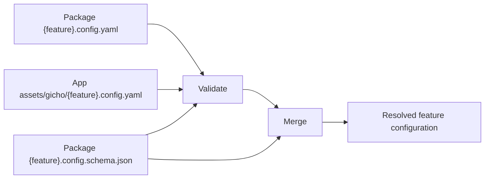

> Historical, mechanically renamed source reference. Unmaintained; not a current
> Gicho package, example, remote-catalog workflow or installation instruction.

# Configuration

The configuration service controls the default and application-specific
behavior of configurable Gicho features.

In this document, **package** means Gicho. **App** means
a Flutter application that depends on this package.

## Feature configuration

Each feature folder owns two configuration files:

```text
lib/src/{feature}/
├── {feature}.config.yaml
└── {feature}.config.schema.json
```

The YAML file contains the package's default settings. The JSON Schema defines
the valid configuration and the rules controlling how package and app values
may be merged.

An app may provide its own configuration for a feature:

```text
assets/gicho/{feature}.config.yaml
```

The app file contains values that customize the package feature. The schema
always belongs to the package; the app does not supply or replace it.

## Configuration process

The configuration service performs three core operations:

1. Load each YAML document into a Dart map using a YAML loader.
2. Validate both the package map and the app map against the package-owned JSON
   Schema using a JSON Schema validation library.
3. Merge the two validated maps using a merge process implemented by this
   package.

The custom merge process obeys the rules declared in the schema. It starts with
the package defaults and applies application values only where the schema
permits an override. Package defaults supply values omitted by the app.

## Schema standard and extensions

Feature schemas use JSON Schema Draft 2020-12. Standard JSON Schema keywords,
including `type`, `properties`, `enum`, `$defs`, `$ref`, and
`additionalProperties`, define and validate the permitted configuration.

Moztopia adds this merge keyword:

```json
"x-moztopia-locked": true
```

`x-moztopia-locked` is not part of the JSON Schema standard. A standard JSON
Schema validator treats it as an unknown annotation and ignores it. The
Moztopia merge process reads it after validation:

- `true` preserves the package value and prevents an app override.
- `false`, or an omitted keyword, permits the app value to override the
  package value.

All future Moztopia-specific schema extensions must use the `x-moztopia-`
prefix so they are clearly distinguishable from standard JSON Schema
keywords.

The result is one validated, resolved configuration map for the feature.



## Runtime behavior

The resolved configuration drives the behavior of its owning feature. Feature
code should consume the resolved configuration rather than reading either YAML
file directly.

The app configuration is optional. When it is absent, the validated package
configuration supplies the complete feature configuration.

## Logging proof of concept

Logging is the first feature implemented with this architecture. The package
owns:

```text
lib/src/logging/logging.config.yaml
lib/src/logging/logging.config.schema.json
```

An app may provide:

```text
assets/gicho/logging.config.yaml
```

During `moztopiaLog.initialize()`, or lazily on the first log call, the logging
feature loads and validates both
logging configuration files, merges them according to
`logging.config.schema.json`, and uses the resolved configuration to create and drive
the package logger.

Flutter asset loading is asynchronous. Await `moztopiaLog.initialize()` before
using the synchronous `moztopiaLog.logger` getter.

Core, logging, localization, and theme currently use this architecture. Core is
the composition layer: it controls whether registered feature-owned UI is
available while Dart controls where it appears. Each feature retains its own
behavior and configuration.

## Configuration reference

Config is infrastructure rather than a configurable feature, so it does not
have `config.config.yaml` or application YAML parameters of its own.

`ConfigurationService.loadFeature(feature)` derives all asset keys from the
feature name. Feature YAML values and their caveats are documented in the
corresponding feature README. See the references for
[`core`](../core/README.md),
[`logging`](../logging/README.md#configuration-reference),
[`localization`](../localization/README.md#configuration-reference), and
[`theme`](../theme/README.md). Calling
`loadFeature` for another feature fails unless that feature adds both its
package YAML and JSON Schema assets.

## Schema bible

This section is the maintained reference for the schema engine. Update it with
the implementation and tests whenever the engine gains a rule, keyword, merge
strategy, or limitation.

### Asset contract

For a feature named `{feature}`, `ConfigurationService` resolves exactly these
keys:

| Purpose | Required | Asset key |
| --- | --- | --- |
| Package defaults | Yes | `packages/moztopia/lib/src/{feature}/{feature}.config.yaml` |
| Package schema | Yes | `packages/moztopia/lib/src/{feature}/{feature}.config.schema.json` |
| App overrides | No | `assets/gicho/{feature}.config.yaml` |

The package must declare its YAML and schema files in the root `pubspec.yaml`.
An app must declare its override in its own `pubspec.yaml`:

```yaml
flutter:
  assets:
    - assets/gicho/
```

Feature names are inserted directly into asset paths. Pass the exact trusted
feature-folder name.

### Resolution order

`loadFeature`:

1. loads the package YAML, package schema, and optional app YAML concurrently;
2. decodes YAML and JSON into ordinary Dart maps and lists;
3. validates the package map against the schema;
4. validates the app map independently against the same schema;
5. merges the two maps using `x-moztopia-locked` annotations; and
6. deep-freezes the result in a `ConfigurationDocument`.

`ConfigurationService` performs one load without retaining global state.
`ConfigurationRegistry` wraps it when the application needs caching and an
aggregate view. The shared `moztopiaConfig` registry is used by the default
configured core, logging, localization, and theme APIs. Its `values` map adds
the feature namespace around each resolved document:

```dart
{
  'core': moztopiaConfig.feature('core')?.values,
  'logging': moztopiaConfig.feature('logging')?.values,
  'localization': moztopiaConfig.feature('localization')?.values,
  'theme': moztopiaConfig.feature('theme')?.values,
}
```

Only successfully loaded features appear. `values` returns defensive nested
copies, so application inspection cannot mutate the stored configuration.

The merged result is not validated a third time. The engine does not perform
environment-variable interpolation, secret resolution, remote loading, or
live reload.

### YAML syntax and rules

The root of each YAML document must be a map, and every map key at every depth
must be a string. Values may be nested maps, lists, strings, numbers, booleans,
or null:

```yaml
enabled: true
retries: 3
endpoint: https://api.example.com
labels:
  - stable
  - mobile
headers:
  accept: application/json
```

An empty file or a file containing only comments becomes an empty map. YAML
anchors and aliases are resolved by the YAML decoder before validation.

These roots are invalid:

```yaml
- a-list
- is-not-a-root-map
```

Non-string nested keys are also invalid:

```yaml
statusCodes:
  200: success
```

### Schema skeleton

Schemas are JSON documents whose root is an object. Start a feature schema with:

```json
{
  "$schema": "https://json-schema.org/draft/2020-12/schema",
  "$id": "https://example.com/schemas/example.config.schema.json",
  "title": "Moztopia example configuration",
  "description": "Validates package defaults and app overrides.",
  "type": "object",
  "additionalProperties": false,
  "properties": {}
}
```

Useful standard keywords include:

- structure: `type`, `properties`, `required`, and `additionalProperties`;
- scalar constraints: `enum`, `const`, `minimum`, `maximum`, `minLength`,
  `maxLength`, and `pattern`;
- collection constraints: `items`, `minItems`, `maxItems`, and `uniqueItems`;
- composition and reuse: `$defs`, `$ref`, `allOf`, `anyOf`, `oneOf`, and `not`;
- documentation: `title`, `description`, `examples`, and `deprecated`.

The installed `json_schema` package performs validation. Confirm less common
keywords against its current behavior and add tests before relying on them.

### Closed objects and unknown keys

Use `additionalProperties: false` at every object level where unknown or
misspelled keys must fail:

```json
{
  "type": "object",
  "additionalProperties": false,
  "properties": {
    "network": {
      "type": "object",
      "additionalProperties": false,
      "properties": {
        "timeoutSeconds": {
          "type": "integer",
          "minimum": 1,
          "maximum": 120
        }
      }
    }
  }
}
```

Closing the root does not close nested objects.

### Enumerations

Use `enum` when Dart code supports a finite vocabulary:

```json
{
  "type": "string",
  "enum": ["compact", "expanded"]
}
```

Keep the enum, Dart conversion logic, package default, and tests synchronized.

### Required fields and partial overrides

Package and app documents are validated independently against the same schema.
A property in `required` must therefore appear in both documents. For example,
this schema rejects an app file that omits `enabled`, even if the package
default supplies it:

```json
{
  "type": "object",
  "required": ["enabled"],
  "properties": {
    "enabled": {"type": "boolean"},
    "color": {"type": "string"}
  }
}
```

Avoid `required` when apps need sparse overrides. The engine does not currently
support separate schemas for complete package defaults and partial app maps.

### Defaults

JSON Schema `default` is descriptive and does not insert a missing value:

```json
{
  "type": "boolean",
  "default": true
}
```

Put every operational default in `{feature}.config.yaml`. Feature code should
not assume the schema materializes defaults.

### Definitions and references

`$defs` and `$ref` may remove repeated validation rules:

```json
{
  "$defs": {
    "color": {
      "type": "string",
      "enum": ["blue", "green", "purple", "red", "yellow"]
    }
  },
  "type": "object",
  "properties": {
    "color": {"$ref": "#/$defs/color"}
  }
}
```

The validator resolves supported references, but the custom merger does not
dereference `$ref`. Put `x-moztopia-locked` directly on the property under
`properties`. Keep nested `properties` inline when nested locking depends on
them.

### `x-moztopia-locked`

This is the engine's only custom keyword:

```json
"x-moztopia-locked": true
```

All future custom keywords must use the `x-moztopia-` prefix.

- `true` retains the package value when the package supplies one.
- `false` permits an app override.
- An omitted annotation is equivalent to `false`.

Place the annotation on the property it controls:

```json
{
  "type": "object",
  "additionalProperties": false,
  "properties": {
    "endpoint": {
      "type": "string",
      "x-moztopia-locked": true
    },
    "timeoutSeconds": {
      "type": "integer",
      "minimum": 1,
      "x-moztopia-locked": false
    }
  }
}
```

Package values:

```yaml
endpoint: https://api.example.com
timeoutSeconds: 30
```

App values:

```yaml
endpoint: https://other.example.com
timeoutSeconds: 60
```

Resolved values:

```yaml
endpoint: https://api.example.com
timeoutSeconds: 60
```

App maps are validated before merging. An invalid value for a locked property
still fails resolution instead of being silently ignored. A locked property
without a package value can currently accept an app value, so every locked
property must have a package default.

### Exact merge rules

| Package value | App value | Locked | Result |
| --- | --- | --- | --- |
| Present | Absent | Either | Package value |
| Absent | Present | Either | App value |
| Present | Present | `true` | Package value |
| Map | Map | `false` or omitted | Recursively merged map |
| Present | Present | `false` or omitted | App value |

Additional rules:

- Scalars replace scalars as complete values.
- Lists replace lists as complete values; items are not appended or merged.
- Maps recurse only when both package and app values are maps.
- Explicit null replaces an unlocked package value when the schema permits it.
- Unknown keys can reach merging only when the schema permits them.
- Inserted maps and lists are deep-copied.

Nested object example:

```yaml
# Package
cache:
  enabled: true
  ttlSeconds: 300
```

```yaml
# App
cache:
  enabled: false
  ttlSeconds: 60
```

If `cache.enabled` is locked and `cache.ttlSeconds` is unlocked, the result is:

```yaml
cache:
  enabled: true
  ttlSeconds: 60
```

List replacement example:

```yaml
# Package
hosts:
  - api-1.moztopia.dev
  - api-2.moztopia.dev
```

```yaml
# App and complete resolved list
hosts:
  - local.example.com
```

### Reading resolved configuration

```dart
import 'package:moztopia/gicho.dart';

const service = ConfigurationService(
  loader: FlutterAssetConfigurationLoader(),
);

final configuration = await service.loadFeature('logging');
final optionalColor = configuration.value('colors.debug');
final boxing = configuration.require<bool>('boxing');
final allValues = configuration.values;
```

`value(path)` traverses dot-separated map keys and returns null when a segment
is absent. It does not traverse list indexes, and a map key containing a
literal dot cannot be addressed separately.

`require<T>(path)` throws `StateError` when the path is missing, null, or not
the requested runtime type. YAML numbers may decode as `int` or `double`, so
request the type guaranteed by the schema.

`ConfigurationDocument` deep-freezes stored maps and lists. Collection values
returned by `value`, `require`, or `values` are defensive copies.

### Errors

Asset, decoding, schema, and validation failures throw
`ConfigurationException`, including:

- a missing required package asset;
- malformed YAML or JSON;
- a YAML root that is not a map;
- a schema root that is not an object;
- a non-string YAML map key;
- an unknown property rejected by `additionalProperties: false`;
- a type, enum, range, pattern, or other validation failure;
- an app document missing a shared-schema `required` property; or
- an invalid app value supplied for a locked property.

The exception's `location` identifies the relevant asset when known.
`ConfigurationDocument.require<T>` instead throws `StateError`, because it is
a resolved-document access error.

### Feature implementation checklist

When adding configuration to another feature:

1. Add complete operational defaults in `{feature}.config.yaml`.
2. Add `{feature}.config.schema.json` using the Draft 2020-12 declaration.
3. Close strict objects with `additionalProperties: false` at every depth.
4. Constrain values to exactly what the Dart implementation supports.
5. Put `x-moztopia-locked` directly on every controlled property.
6. Supply a package default for every locked property.
7. Avoid `required` when app overrides need to remain sparse.
8. Declare both package assets in the root `pubspec.yaml`.
9. Load through `ConfigurationService` during feature initialization.
10. Convert the resolved document into typed runtime settings.
11. Add a feature-specific configuration reference and link back here.
12. Test defaults, overrides, locks, invalid types, unknown keys, enums, a
    missing app file, and defensive copies.

Do not create a second schema or merge implementation inside a feature. A new
engine rule or `x-moztopia-` extension requires implementation tests and an
update to this schema bible before features depend on it.

### Current limitations

The engine does not currently provide:

- separate package and partial-app schemas;
- insertion of JSON Schema `default` values;
- list append, set, or keyed-item merge strategies;
- `$ref` resolution in the custom merge phase;
- environment or secret interpolation;
- remote configuration or live reload;
- list-index traversal in `ConfigurationDocument` paths;
- generated typed configuration models; or
- schema migrations between package releases.

Treat these behaviors as unsupported until the implementation, tests, and this
reference are updated together.
